# Sphere Descent

A 3D rolling-ball maze game made in Unity, with a synthwave (or deep-sea) look. You steer a small ball across the outside of a planet covered in neon-lit maze walls. You drop through holes onto smaller spheres nested inside, and sometimes climb back up, until you reach the glowing core at the center.

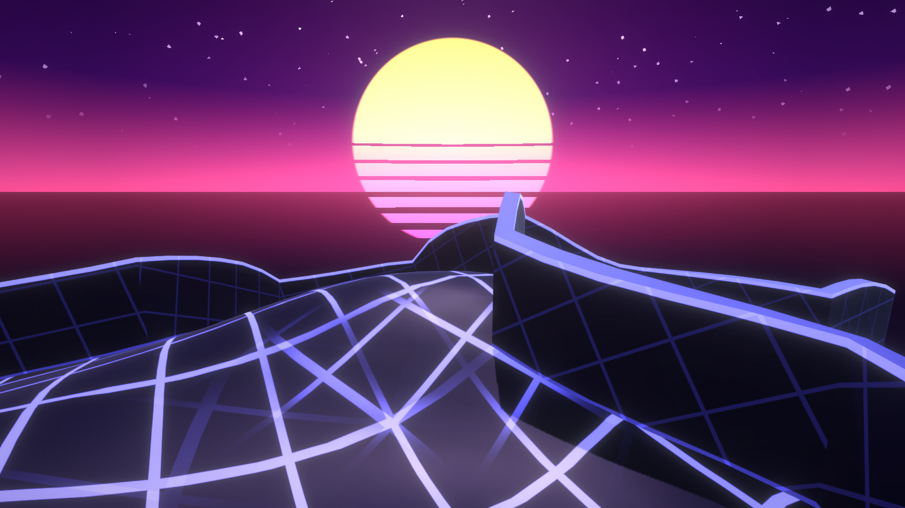

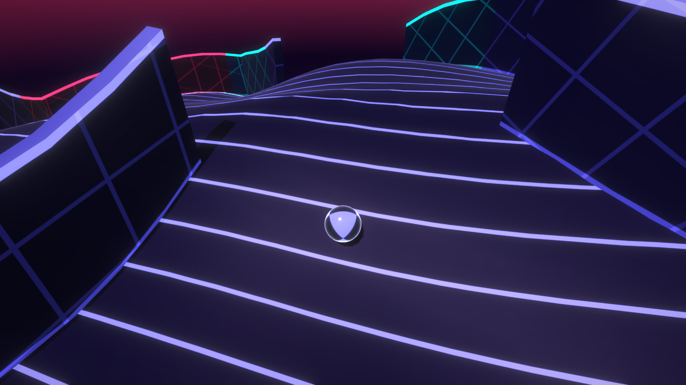

> **Status:** early prototype. The core loop and three kinds of hazard work, but tuning, sound and a proper menu are still to come.

## How it plays

Each world is a set of nested spheres: a surface shell, three smaller shells inside it, and a solid core. Gravity always pulls toward the center, so you roll on the outside of whichever shell you're on.

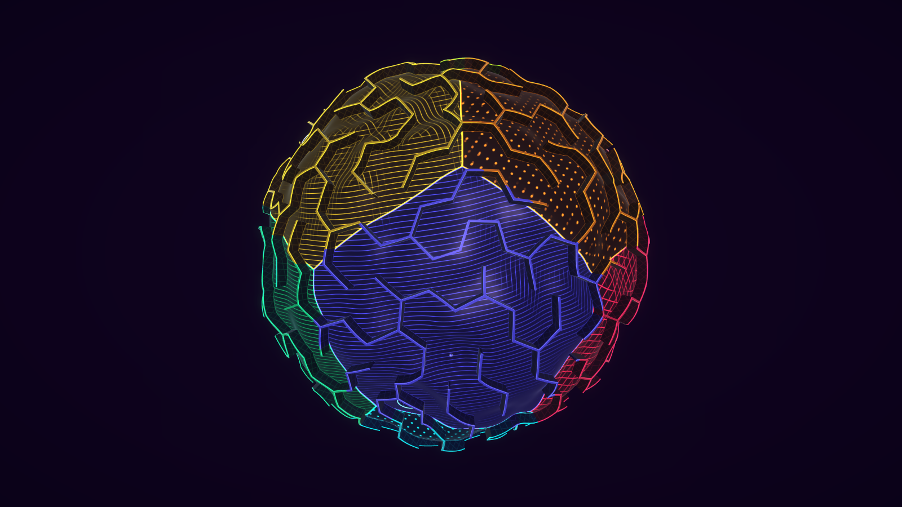

- **Sections.** A world is a chain of short maze sections, each taking around a minute. A section has a main path with side lanes that branch off and rejoin it. There are several routes but no dead ends, and every route leads to the same spot.
- **Dropping down.** Most sections end at a hole marked with a glowing ring. Roll into it to fall to the next section on the shell below.
- **Climbing up.** Some sections end at a cyan boost pad. Roll onto it and it launches you up through the hole above into the next section on the shell above. Jumping alone is too low to reach the layer above, and the maze walls are too tall to jump over.
- **Mines.** Groups of blinking red mines lie along each section's route, with more beside the walls so you can't just hug a wall past them. Weave between them or jump over them: touching one blows you up and sends you back to where you last arrived on that sphere.
- **Laser gates.** Every other section has a gate of lasers across a doorway you can't get around. Find the pad nearby on your side, usually down a short side path: it pulses red while the lasers are on and turns green when you roll over it, switching them off. Touching the lasers blows you up like a mine.
- **Security cameras.** The other sections have a run of three cameras on poles above the walls, on alternating sides of the passage. Each sweeps a spotlight across a doorway in its own pattern (a figure-8, a circle, or darting from side to side and holding). Time your run through the gaps: if the light catches you, it locks on and the camera shoots you with a laser.
- **Energy cubes.** Each section has 10 glowing cubes to collect: half along the main route, half tucked away down side lanes and around corners. Roll through one for a point. One hidden cube per section is a larger magenta super cube worth 5. Your score is on the HUD.
- **Escaping.** The last section drops you onto the gold core. Touching down anywhere on it completes the world, and the next world starts with a new maze.

| Section end: a hole to drop through | Section end: a boost pad to climb |
|---|---|
| 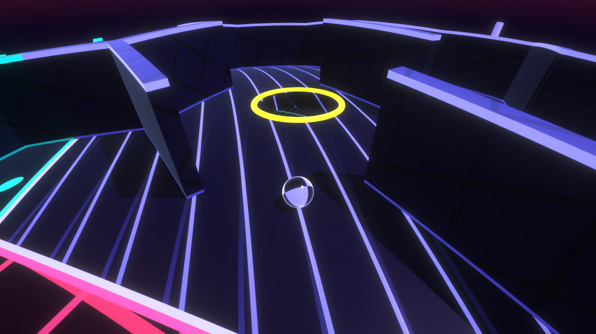 | 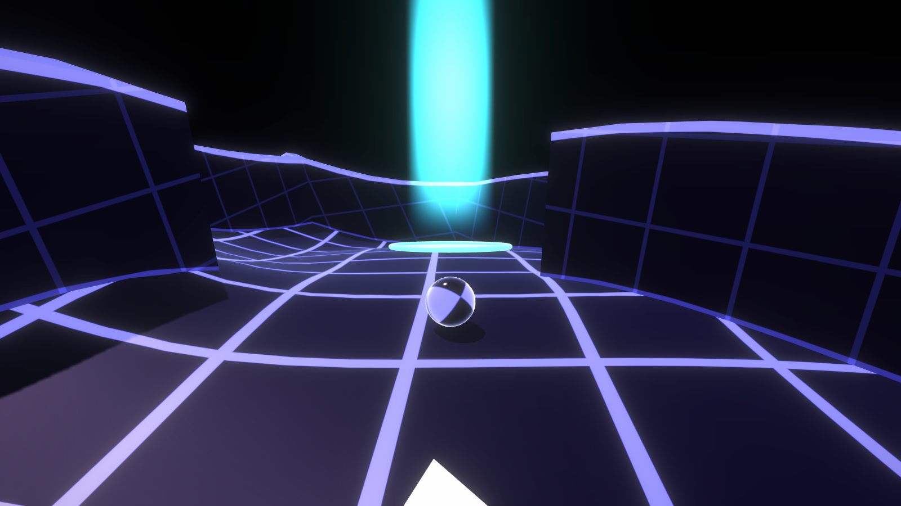 |

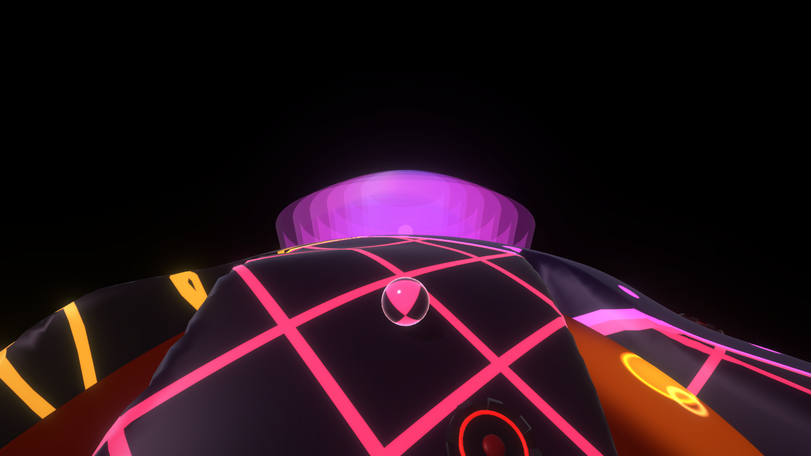

| Mines along the route | A laser gate across a doorway | The pad that switches it off |
|---|---|---|
| 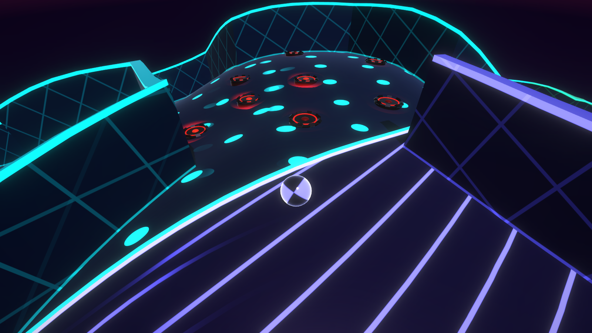 | 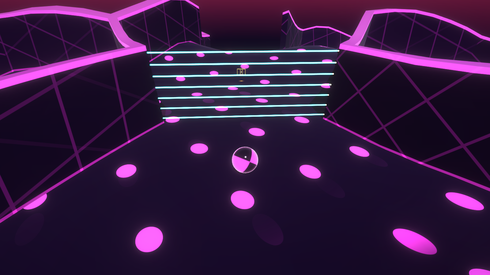 | 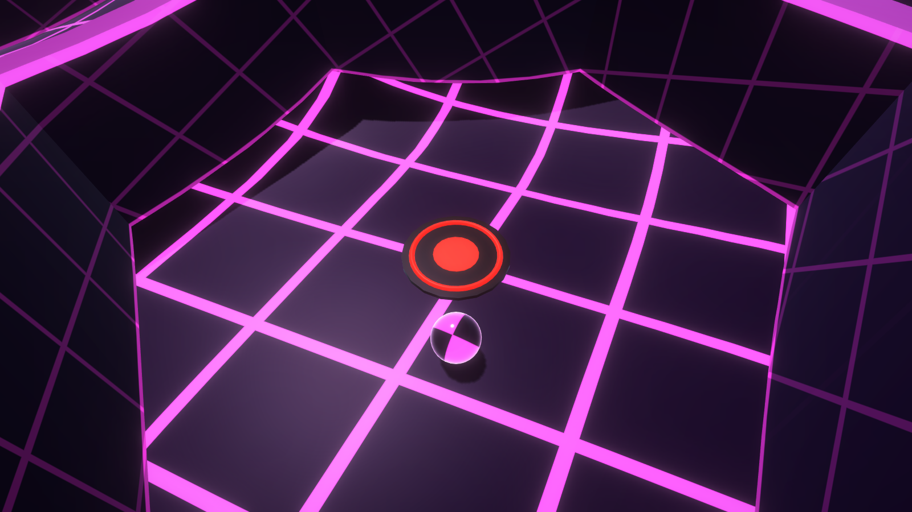 |

| Security cameras sweeping a passage | Caught in the light |
|---|---|
| 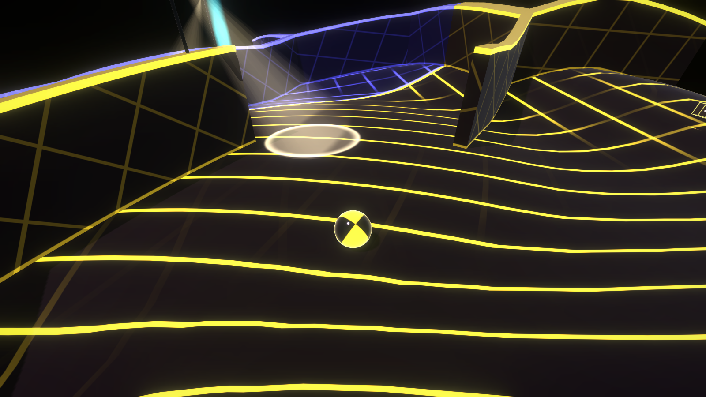 | 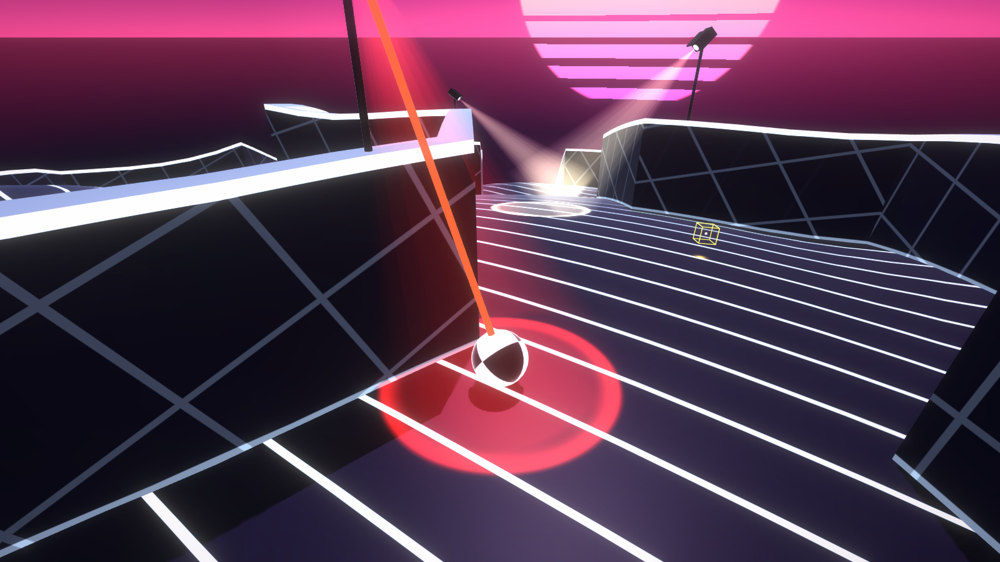 |

To help you find your way, each sphere is split into 12 zones, each with its own neon color and line pattern: square grid, diagonal grid, stripes or dots. The zones line up through every layer. A beam of light rises from where the section you're in ends, orange over a hole to drop through or cyan over a boost pad to climb from, so you can spot it over the maze walls. The HUD shows the world, section, layer and zone you're in.

## Look

Everything is drawn by shaders, with no image files. There are two styles: **Synthwave** (the default) and **Deep Sea**. Press M to open a menu where you can pick a style (or alternate them every world) and which world to play. Hole rings, pads, beams, hazards and the gold core look the same in both, so they always mean the same thing. The HUD shows the frame time and style in the top right. Styles are defined in `Assets/Scripts/Level/VisualStyle.cs` and listed on the GameManager, where they can be tuned or added to.

Synthwave:

- **Floors:** dark, with glowing anti-aliased lines in the zone's neon color (`Assets/Shaders/TriplanarGrid.shader`).
- **Walls:** dark panels with a neon strip along the top edge.
- **Ball:** eight equal segments, like a crash-test ball, alternating glossy black and neon in the color of the zone you're in. The color fades smoothly as you cross a border.
- **Sky:** a purple-to-magenta gradient with stars and a striped retro sun on the horizon (`Assets/Shaders/SynthwaveSky.shader`). It follows your local "up" wherever you are on the planet.
- **Glow:** bloom and a light vignette from URP post-processing (`Assets/Settings/PostProcessing.asset`).

Deep Sea: dark blue-green surfaces glowing in softer bioluminescent zone colors, with caustic light rippling over floors and walls (a tiling pattern computed at startup). The sky is water, brightest overhead, with swaying shafts of light and drifting specks; a blue haze fills the distance and specks drift around the camera.

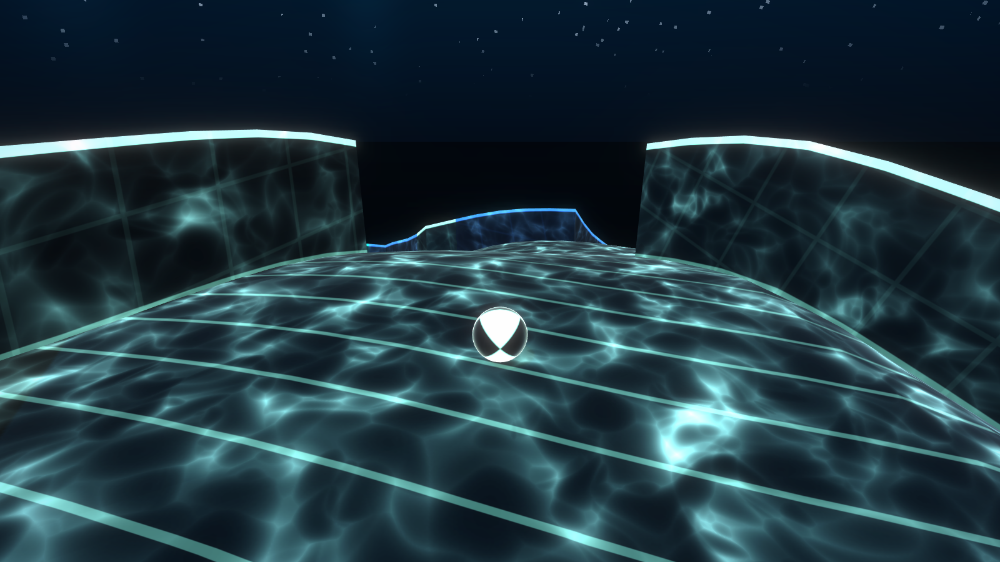

## Controls

| Action | Keyboard / mouse | Gamepad |
|---|---|---|
| Roll (relative to the camera) | W A S D | Left stick or D-pad |
| Back up (camera keeps facing forward) | S | Stick / D-pad down |
| Jump | Space | A / South button |
| Turn the camera | Mouse (click to capture), or Q / E | Right stick |
| Respawn on the current layer | R | Select / View |
| Release the mouse | Esc | |
| Menu: style and world | M | Start |
| Skip to the next world (testing) | N | |

## Running it

1. Install **Unity 6000.6.6f1** with Unity Hub.
2. Add this folder as a project in Unity Hub and open it.
3. Open `Assets/Scenes/Main.unity` and press **Play**.

The project uses the Universal Render Pipeline (URP) and the Input System package, both included with Unity.

## How worlds are generated

Every world is generated in code from a seed (`Assets/Scripts/Level/MazeLayout.cs`):

1. **Plan the route.** Choose which shell each section is on, going one layer down or up at a time. The route starts on the surface and finishes on the innermost shell. Each world has a set number of climbs back up.
2. **Grow each section.** Lay a winding main path from where you arrive. Add side lanes beside it, open walls so the lanes loop back with no dead ends, and wall off a few steps of the main path so the route weaves through the lanes.
3. **Link the sections.** End the section at a hole above a free spot on the shell below, or at a boost pad under a free spot on the shell above. That spot is where the next section starts.
4. **Fill the rest.** Give cells outside any section a sealed-off maze, so every shell still looks like a maze.

Every shell has the same corridor width, so the smaller inner spheres have fewer cells rather than narrower corridors.

### Tuning

Most settings live on the **Game Manager** object in the Inspector:

- **Climbs Per World:** how many times you have to climb back up. Each climb adds two sections.
- **Section Length Min / Max:** the length of each section's main path, in maze cells.
- **Side Lane Chance:** how wide sections are, and how many alternative routes they have.
- **Main Path Cut Chance:** how often the main path is walled off, forcing a detour.
- **Energy cubes:** how many per section, how many are hidden, points, and size.
- **Laser gates:** how often (every Nth section) and how many lasers each gate has.
- **Security cameras:** how often, how many per run, and the spotlight's size, speed and reach.
- **Mines:** groups per section, mines per group (the ones beside the walls count too), size, the gap left beside walls, and how many of the smallest spheres get fewer.
- **Shell radii**, **Cell Spacing** (corridor width), **wall height**, **hole size**, **beam height**, and the **Base Seed**.

The ball's speed, jump height and gravity are set on the `BallController`, and the camera's distance, pitch and follow behavior on the `OrbitCamera`.

## Project layout

```
Assets/
  Scripts/
    Gameplay/   ball, camera, input, boost pads, game manager and HUD
    Geometry/   icosphere, hex/pentagon sphere grid, mesh builders
    Level/      maze generation, level building, zones, settings
  Shaders/      neon zone/grid shader and synthwave skybox (URP)
  Settings/     URP pipeline, renderer, global and post-processing settings
  Editor/       scene setup and test tools
  Scenes/       Main.unity
Docs/screenshots/  images used in this README
```

The **Sphere Descent** menu in the editor can rebuild the main scene, run a world-generation check, and re-render these screenshots (**Render README Screenshots**).
